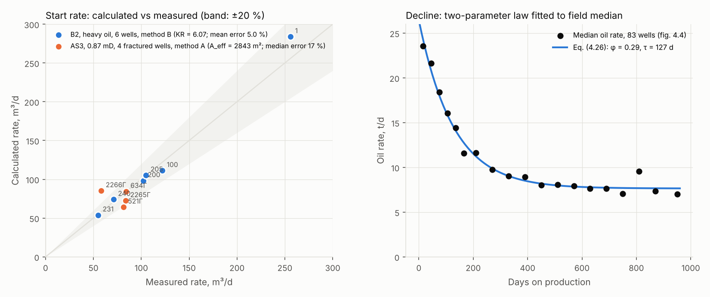

# TRIZ-NF — oil production forecasting under non-linear flow

*Русская версия: [README.ru.md](README.ru.md)*

TRIZ-NF forecasts oil production and project economics for hard-to-recover
reserves (Russian "ТРИЗ": tight, heavy-oil and gas-cap reservoirs) where the
linear Darcy law no longer holds. It implements the analytic models from my
Candidate of Sciences thesis, *A mathematical model of oil recovery under
non-linear fluid flow to horizontal wells*, and was validated on field data
from four Russian oilfields.

The program is a single-page web application with no server and no external
network calls: open `index.html` and work offline. The computational core is a
dependency-free JavaScript module that also runs under Node.js, which is how
the tests below execute it.

Registered with the Russian Federal Service for Intellectual Property
(Rospatent) as computer program no. 2026692814, 25 October 2026.
Author and rights holder: Oksana N. Shevchenko.
The production-forecast method implemented in `src/core.js` (method A and the
decline model) is the subject of a Russian invention patent application no. 2026133768, filed
on 3 November 2026 (patent pending).



*Left: start rates calculated by the program versus measured rates for the
two field cases published in the thesis. Right: the two-parameter decline law
fitted to the median rate history of 83 fractured horizontal wells.*

## What it computes

**Start rate of a well** by one of three methods, chosen automatically from the
well construction and fluid:

| Method | Physics | Typical use | Thesis eq. |
|---|---|---|---|
| A | Darcy inflow to *n* transverse fractures, corrected by the non-linear-flow coefficient K_nf = min{1, (A_eff / A_t)^γ}, where A_t = 2·n·x_f·h is the total fracture face and A_eff the effective (calibrated) face | Multi-stage fractured horizontal wells in reservoirs below ~1 mD | (4.3)–(4.5) |
| B | Flow with an initial (threshold) pressure gradient H₀(k) and a Forchheimer inertial term, over an equivalent drainage radius R = K_R·√(χ·t) | Horizontal wells in heavy (structured) oil | (4.29)–(4.31), (4.6a) |
| C | Two-term (power-law) inflow equation to a horizontal well in a strip reservoir of width *w*; the non-linear zone r* = q/(2π·w*) is solved for by bisection | Horizontal and multilateral wells without fracturing | (3.36)–(3.39) |

Seventeen well constructions are supported, from vertical wells to fishbones,
multilateral wells with fracturing and radial drilling.

**Decline** by a two-reservoir elastic model
f(t) = a·e^(−t/τ₁) + (1−a)·e^(−t/τ₂); with τ₂ → ∞ it becomes the pressure-maintenance
form (4.26) with support fraction φ = 1 − a, and φ can be estimated from
permeability (4.32).

**Field forecast** for a drilling schedule, with and without pressure
maintenance, probabilistic P90/P50/P10 profiles, reserve caps and pump limits.

**Economics**: operator cash flow (revenue − severance tax − OPEX − property
tax − profit tax − CAPEX), NPV, IRR, payback.

**Calibration** of K_R, the acting gradient or A_eff against analogue wells,
with leave-one-out cross-validation, and decline fitting by Nelder–Mead.

**Reports** in Excel, Word and PowerPoint, generated in the browser.

## Validation

The data published in the thesis are embedded in `src/data.js` and the
program's own "About" page reproduces the published numbers. The test suite
checks the same reproduction plus the analytic limits of the models:

```
$ node --test test/*.test.js
✔ initial pressure gradient vanishes in the Darcy regime (k >= 8 mD)
✔ initial pressure gradient grows as permeability falls below 8 mD
✔ theoretical drainage-radius coefficient KR = 2/sqrt(e^gamma) ~ 1.50 (eq. 4.6a)
✔ decline law (4.26): f(0) = 1 and f(t) -> 1 - a as t -> inf when tau2 = inf
✔ cumulative decline (4.26) is the integral of f: d/dt N(t) = f(t)
✔ method C reduces to the Darcy (linear) solution when the inertial coefficient -> 0
✔ method C: the rate is a non-increasing function of the inertial coefficient C
✔ method A: the non-linear-flow coefficient K_nf never exceeds 1
✔ formation B2 (6 horizontal wells, heavy oil): calibrated KR = 6.07, mean error 5.0 %, LOO 6.0 % (table 4.5)
✔ formation AS3 (4 multi-fractured horizontal wells, k = 0.87 mD): A_eff = 2843 m2, median error ~17 % (table 4.1)
✔ formation AS3 median decline (fig. 4.4): fitted phi = 0.29, tau = 127 d (table 4.4)
✔ field forecast: annual oil equals the sum of well volumes and never goes negative
```

| Case | Wells | Model | Error |
|---|---|---|---|
| Formation B2, heavy oil (μ = 209 mPa·s) | 6 horizontal wells | Method B, K_R = 6.07 | mean 5.0 %, leave-one-out 6.0 % |
| Formation AS3, tight (k = 0.87 mD) | 4 fractured horizontal wells with measured drawdown | Method A, A_eff = 2843 m² | median 17 % |
| Formation AS3, decline | median of 83 wells | eq. (4.26) | φ = 0.29, τ = 127 d |

The thesis reports a nested cross-validation on 80 fractured wells across
20 pads (median absolute error 17.4 %); the per-well inputs of that larger set
are the operator's and are not included here.

## Run

Open `index.html` in any modern browser, or use the single-file build in
`dist/`, which is the exact file registered with Rospatent. Nothing is sent
anywhere; projects are saved as `.json` on your machine.

Tests need Node.js ≥ 18:

```
node --test test/*.test.js
```

To regenerate the validation figure:

```
node scripts/validation_figure.js      # writes docs/validation.json
python3 scripts/validation_figure.py   # writes docs/validation.png (needs matplotlib)
```

## Layout

```
index.html        page shell
src/core.js       computational core: start rates, decline, field forecast, calibration (CommonJS-compatible)
src/econ.js       cash flow, NPV, IRR
src/data.js       published field data used for self-check
src/charts.js     SVG charts, no dependencies
src/xlsx.js       minimal XLSX writer on JSZip
src/dataio.js     project and input-template import/export
src/reports.js    Excel / Word / PowerPoint report builders
src/ui.js         user interface
vendor/           third-party libraries (docx, PptxGenJS, JSZip), MIT licensed
dist/             single-file build as registered
test/             node:test suite
scripts/          validation figure
```

## How it was built

I derived the mathematics and designed the program; the implementation was
written with AI coding assistants from my specifications and verified against
closed-form limits and the field data above. The one defect that reached
end-to-end testing was in the output-file format, a part I had not specified.

## Licence

Source available for reading, review and non-commercial use under the terms
in [LICENSE](LICENSE). Commercial use requires a written licence from the
author. Third-party components keep their own MIT licences
(`vendor/LICENSES-THIRD-PARTY.js`).

## Citation

Shevchenko O.N. *TRIZ-NF: oil production forecasting and economic evaluation
of hard-to-recover reserves based on a non-linear filtration law.* Computer
program, Rospatent reg. no. 2026692814, 2026.

Key papers behind the models:

- Shevchenko O., Astafev V. The method of analytic calculation of initial and ultimate pressure gradients to flow for low-permeability reservoirs. In: *Advances in Petroleum Engineering and Petroleum Geochemistry*, Springer, 2019. DOI 10.1007/978-3-030-01578-7_4
- Astafiev V.I., Shevchenko O.N., Kibalenko I.A. The mathematical model of the filtration process in horizontal wells for high-viscosity oil fields. *International Journal of Mechanics*, 2017, 11, 242–250
- Shevchenko O.N. Forecasting horizontal-well rates under non-linear flow. *Neftyanoe Khozyaystvo (Oil Industry)*, 2020, no. 6
