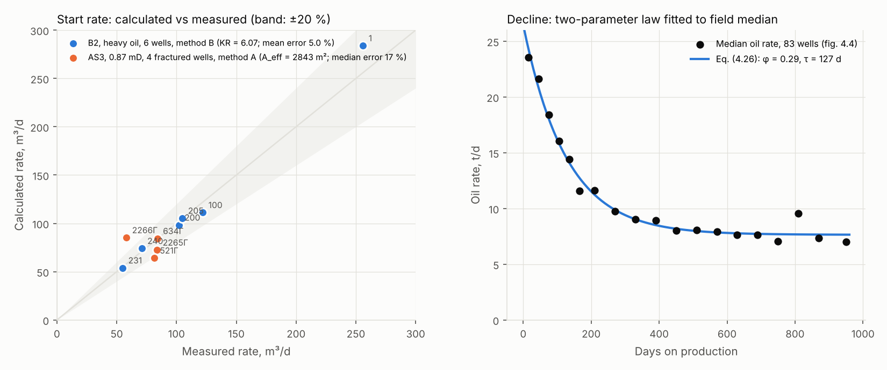

# ТРИЗ-НФ — прогноз добычи нефти при нелинейной фильтрации

*English version: [README.md](README.md)*

ТРИЗ-НФ рассчитывает прогноз добычи нефти и экономику разработки залежей с
трудноизвлекаемыми запасами (низкопроницаемые коллекторы, высоковязкая нефть,
газовые шапки), где линейный закон Дарси не выполняется. Реализованы
аналитические модели кандидатской диссертации «Математическая модель
нефтеизвлечения в условиях нелинейной фильтрации жидкости к горизонтальным
скважинам», проверенные на промысловых данных четырёх месторождений.

Программа — одностраничное веб-приложение без сервера и без обращений в сеть:
откройте `index.html` и работайте без интернета. Расчётное ядро — модуль
JavaScript без зависимостей, который запускается и под Node.js; так выполняются
тесты.

Зарегистрирована в Роспатенте: программа для ЭВМ № 2026692814 от 25.10.2026.
Автор и правообладатель — Шевченко Оксана Николаевна.
Способ прогнозирования дебита, реализованный в `src/core.js` (метод A и модель
падения дебита), заявлен на изобретение: заявка в Роспатент № 2026133768 подана 03.11.2026.



## Что считает

**Стартовый дебит скважины** одним из трёх методов, выбираемых по конструкции
скважины и флюиду: A — приток по Дарси к n поперечным трещинам с коэффициентом
нелинейной фильтрации Kнф = min{1; (Aэф/Aт)^γ}, формулы (4.3)–(4.5); B —
фильтрация с начальным градиентом H₀(k) и инерционным членом Форхгеймера на
эквивалентном радиусе дренирования R = KR·√(χt), (4.29)–(4.31), (4.6а); C —
двучленное уравнение притока к ГС в пласте-полосе, (3.36)–(3.39). Поддерживается
17 конструкций скважин — от вертикальных до фишбонов, многозабойных с МГРП и
радиального вскрытия.

**Падение дебита** по двухъёмной модели упругого режима (4.34), предельный
случай (4.26) с долей подпитки φ; **прогноз по объекту** с графиком бурения, с
ППД и без, профили P90/P50/P10; **экономика** (ЧДД, ВНД, окупаемость);
**калибровка** по скважинам-аналогам с перекрёстной проверкой; **отчёты** в
Excel, Word и PowerPoint.

## Проверка

Опубликованные в диссертации данные встроены в `src/data.js`; тесты
воспроизводят опубликованные числа и проверяют аналитические пределы моделей:

```
node --test test/*.test.js
```

| Случай | Скважины | Модель | Ошибка |
|---|---|---|---|
| Пласт Б2, высоковязкая нефть (μ = 209 мПа·с) | 6 ГС | метод B, KR = 6,07 | средняя 5,0 %, перекрёстная 6,0 % |
| Пласт АС3, k = 0,87 мД | 4 ГС с МГРП с замеренной депрессией | метод A, Aэф = 2843 м² | медианная 17 % |
| Пласт АС3, падение | медиана 83 ГС | (4.26) | φ = 0,29, τ = 127 сут |

В диссертации приведена также вложенная перекрёстная проверка на 80 ГС /
20 кустах (медианная ошибка 17,4 %); исходные данные по этим скважинам
принадлежат недропользователю и в репозиторий не включены.

## Запуск

Откройте `index.html` в браузере или используйте однофайловую сборку в `dist/`
— это тот самый файл, что зарегистрирован в Роспатенте. Тесты: Node.js ≥ 18,
`node --test test/*.test.js`.

## Как создавалась

Математика и архитектура программы — мои; реализация написана с помощью
ИИ-ассистентов по моим спецификациям и проверена по аналитическим пределам и
промысловым данным. Единственный дефект, дошедший до сквозных тестов, был в
формате выходного файла — в части, которую я не специфицировала.

## Лицензия

Исходный код открыт для чтения, рецензирования и некоммерческого
использования на условиях файла [LICENSE](LICENSE). Коммерческое использование
— по письменной лицензии автора. Сторонние библиотеки сохраняют свои лицензии
MIT (`vendor/LICENSES-THIRD-PARTY.js`).
